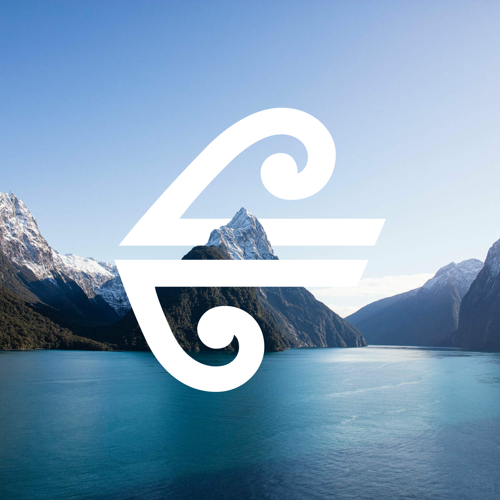
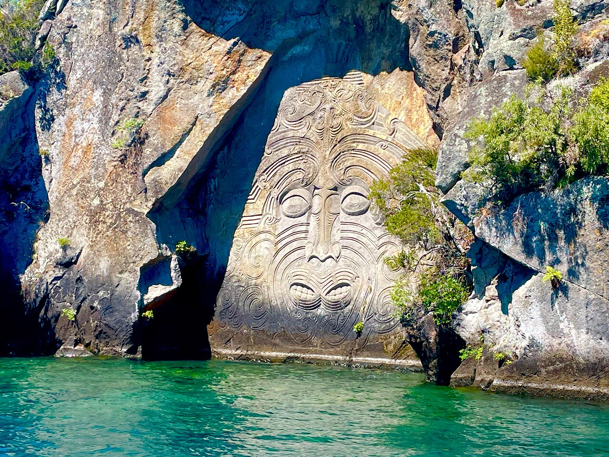

{style="border-radius: 20px;" width="100%" fig-align="left"}

**Kia ora all,**

Our wedding will be held on the 23rd of January, 2027 NZDT. The ceremony will be at our house - 23 Kererū street, Taupō, New Zealand.

This site is to provide you with some details about logistics, and to help everyone stay organised. There are more pages in this website. These other pages are visible either in a horizontal bar across the top of this page, or by clicking the three bars in the upper left corner.

To the yanks coming all this way - we want to help to make this a smooth trip for you, and appreciate that NZ is a long way to travel for a wedding. Hopefully after visiting you will understand why we have chosen to live here.

We hope this can be treated as forced vacation for all of you. The word "forced" meaning that you will feel strongly obliged to take some time off work, and treat yourself to a vacation. We understand this is an expensive trip, and are not taking your attendance for granted.

## On the day information

For the wedding day schedule, see [this page](on_the_day.qmd).

### Venue
The ceremony will be held at our house - 23 Kererū street. It's the mansion at the end of the street. Actually it's not a mansion, but hopefully we will all fit. After the ceremony there will be a lot of mingling on our feet, so keep that in mind when picking shoes.

### parking and travel
There is plenty of on-street parking on Kererū street. Also, Taupō is a small town with many cycle lanes. So drive, walk, bike - whatever you want. You will need to organise travel from the ceremony to [Acacia Bay Community Hall](https://maps.app.goo.gl/RxL2j1eTcrj8ATm98)  for the reception. Uber, taxis, or shuttles are available for this. See [this page](on_the_day.qmd) for more details.

### Dress Code
This is a lowkey event, but still a formal one. Dress in your best clothes, whatever that may be :smiley:. It's a summer garden wedding, so leave the tuxedos at home and wear bright and bold summer garden colours.

### Wedding size
This is a small event with only our closest friends and family invited. Please no plus-ones or children unless specified. Exclusive, chic, fashionable :nail_care:.

## Other Information
### Accommodation Options
Taupō has many places to stay. We do not have any specific recommendations, but do recommend you use for following sites for your search:

[Holiday homes](https://www.holidayhouses.co.nz/)

[Airbnb](https://www.airbnb.co.nz/)

[BookaBach](https://www.bookabach.co.nz/)

Because of the volume of accommodation options you can be choosy. We recommend getting something within a few km's of our house.

### Getting to NZ

{style="border-radius: 20px;" width=90% fig-align="center"}

There are a 3 or so airlines that fly to New Zealand direct from U.S.A. We have flown on a few of them, and from those experiences, recommend Air New Zealand. AirNZ has nice planes, service, food, and offer a great option those with babies of a thing called the "sky couch". Air New Zealand is also a member of the Star Alliance so you can use points you have accumulated from other Star Alliance airlines (such as United airlines).

AirNZ flies direct to Auckland NZ from Los Angles, San Francisco, New York, Vancouver, and Houston. From Auckland you can fly to Taupō (a 50 min. flight). The flight from Auckland to Taupō is less than \$80 USD so that probably makes the most sense. We encourage you to send us your flights before you book them, sometimes the slightly cheaper option will send you the wrong way around the world and be much worse.

## Things to do in Taupō

Please look at [this website](https://www.lovetaupo.com/en/) if you want ideas on things to do here.

Some of our recommendations/favourites are found below, [here](#to-eat-and-drink) and [here](#to-do).

Taupō is a small town in the centre of the north island of NZ. We lived in Dunedin, Wellington, and have now landed here. Taupō is known for it's natural beauty, big ass lake, tourist attractions, and proximity to the mountain. The natural beauty highlights include geothermal pools, the maunga Ruapehū, and swimming spots. Although there are many tourists, it still feels like a small town. Lake Taupō is the biggest lake in NZ, and feels a lot like lake Michigan in terms of its clarity and summer temperature.

Because of the tourist industry there is lots to do in Taupō. We have bungy jumping, sky diving, river jet boat rides, fly fishing, wine tasting, beaches.. the list is endless really. We've provided some recommendations below to at least give you a place to start.

{style="border-radius: 20px;" width=90% fig-align="center"}

*Whakamoenga Point Rock Carvings*

## To eat and drink

### Lionel's

<iframe src="https://www.google.com/maps/embed?pb=!1m18!1m12!1m3!1d2558.629194355535!2d176.0723675752851!3d-38.69144848470662!2m3!1f0!2f0!3f0!3m2!1i1024!2i768!4f13.1!3m3!1m2!1s0x6d6bf1c2d8a97a57%3A0xcecea9c1dc82a6ba!2sLionel's!5e1!3m2!1sen!2snz!4v1786396831355!5m2!1sen!2snz" width="600" height="450" style="border:0;" allowfullscreen="" loading="lazy" referrerpolicy="strict-origin-when-cross-origin"></iframe>

[:thumbsup:]{style="font-size: 200%;"}

- Food is excellent,
- vibe is excellent,
- covered seating,
- Our favourite restaurant in town.

[:thumbsdown:]{style="font-size: 200%;"}

- None. Go there.

---

### Two Mile Bay Sailing Club

<iframe src="https://www.google.com/maps/embed?pb=!1m18!1m12!1m3!1d2557.8323637403446!2d176.08142257528644!3d-38.7137222860057!2m3!1f0!2f0!3f0!3m2!1i1024!2i768!4f13.1!3m3!1m2!1s0x6d6bf08785d891a3%3A0xbb2f9320cd6e5344!2sTwo%20Mile%20Bay%20Sailing%20Club!5e1!3m2!1sen!2snz!4v1786396867720!5m2!1sen!2snz" width="600" height="450" style="border:0;" allowfullscreen="" loading="lazy" referrerpolicy="strict-origin-when-cross-origin"></iframe>

[:thumbsup:]{style="font-size: 200%;"}

- Locals favourite,
- in Two Mile Bay,
- little ones (and Zach) can swim while adults drink,

[:thumbsdown:]{style="font-size: 200%;"}

- Only sell one beer,
- only do pizza

---

### Thai Delight

<iframe src="https://www.google.com/maps/embed?pb=!1m18!1m12!1m3!1d653372.7142368117!2d174.4060140921542!3d-38.8698218126495!2m3!1f0!2f0!3f0!3m2!1i1024!2i768!4f13.1!3m3!1m2!1s0x6d6bf12df2ea0a21%3A0xa2594ee3fd34caee!2sThai%20Delight%20Restaurant%20Taupo!5e1!3m2!1sen!2snz!4v1786396900449!5m2!1sen!2snz" width="600" height="450" style="border:0;" allowfullscreen="" loading="lazy" referrerpolicy="strict-origin-when-cross-origin"></iframe>

[:thumbsup:]{style="font-size: 200%;"}

- Centre of town,
- good food,
- really nice staff.

[:thumbsdown:]{style="font-size: 200%;"}

- Won't blow your socks off. But will be good.

---

### Ploughmans Restaurant

<iframe src="https://www.google.com/maps/embed?pb=!1m18!1m12!1m3!1d2557.661505234111!2d176.07835767528675!3d-38.71849688628421!2m3!1f0!2f0!3f0!3m2!1i1024!2i768!4f13.1!3m3!1m2!1s0x6d6bf0637e2e9f59%3A0x5a3ea5319d3ef51a!2sPloughmans%20Restaurant!5e1!3m2!1sen!2snz!4v1786396920162!5m2!1sen!2snz" width="600" height="450" style="border:0;" allowfullscreen="" loading="lazy" referrerpolicy="strict-origin-when-cross-origin"></iframe>

[:thumbsup:]{style="font-size: 200%;"}

- Nice atmosphere for a drink,
- outdoor seating,
- next to "Fish Box" fish-and-chips,
- in Two Mile Bay

[:thumbsdown:]{style="font-size: 200%;"}

- grumpy waitress,
- cannot vouch for food.

---

## To do

### our favourite swimming spots
- Whakaipo bay
- [Otumuheke Stream](https://maps.app.goo.gl/uHjvP1fDLHNv5pMW9)
   - See [this link](https://www.lovetaupo.com/en/scenic-attractions/otumuheke-stream/) for more information.
- Whakamoenga Point
   - park at [Rangatira Point car park](https://maps.app.goo.gl/AfKyNYZW7WpFGikE8)
   - Follow the track west until it ends. You are there.
- Kinloch beach
   - General store is cute and has good ice cream.
- [Town beach](https://maps.app.goo.gl/1XxPv1tgYo6TK5Y59)

### walks
- Waipāhīhī Botanical Reserve
   - Really nice place to go for a walk. Great views, great bush.
- [Mount Tauhaura](https://www.lovetaupo.com/en/scenic-attractions/mt-tauhara/). It's the maunga you see right next to town.

### cycling
- You can rent bikes from lots of places. "Pack & Pedal" is our local bike shop so I recommend them.
- Cycle the W2K trail.
  - Bike about 26 km round trip from Whakaipo to Kinloch. Great bush and lake views. See [this link](https://www.lovetaupo.com/en/scenic-attractions/w2k-trail-great-lake-trails/) for more information. 
- Cycle along the lakefront. A nice cruizey in-town ride. Can still make it over 25 kms if you do the entire thing.

### Hot pools/regular pools
- Wairakei terraces
   - A few minutes out of town. Our favourite.
   - Book [here](https://new.grabone.co.nz/activities-events-outdoors/volcanic-geothermal/p/wairakei-terraces-1996?adult=true) for a discount.
- Debretts.
   - Got waterslides 'n stuff.
- AC Baths
   - Local gym and outdoor pool we like.

There are also multiple ways to take a boat tour on the lake. Once again have a look at [this website](https://www.lovetaupo.com/en/) to see the options.

---

There are more pages on this site. Please see those for additional information.

Once again we are so grateful for the efforts you are taking to celebrate with us. This wedding marks the continuation of our relationship and life we have here. We look forward to celebrating this with you.

**Ngā mihi,\
John and Ella**

