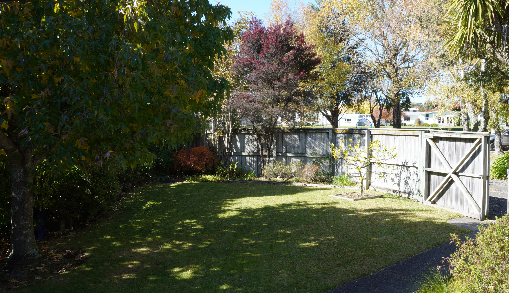

{style="border-radius: 20px;" width=100% fig-align="left"}

*The venue - our front yard*

  <i class="bi bi-info-circle"></i> <strong>Note:</strong> The exact times of each event may change slightly! <button type="button" class="btn-close" data-bs-dismiss="alert" aria-label="Close"></button>

## 1:45 p.m.
Arrive for ceremony.

[23 Kererū Street, Two Mile Bay, Taupō](https://maps.app.goo.gl/5j7wxeS9yqPQtbhw8)

Park on the street.

## 2:00 - 2:30 p.m.
Ceremony

Will probably be ~20 minutes.

{style="border-radius: 30px;" width=10% fig-align="left"}

## 3:15 - 5:30 p.m.
Photos, canapés, and drinks.

- Please pick one glass and reuse it.

## 5:30 p.m.
Travel to Acacia Bay for reception. Here we  will have speeches, dinner, desserts, and dancing. In that order.

Hosted at [Acacia Bay Community Hall](https://maps.app.goo.gl/fYhJowR7BJh6WMRZ9) (10 km away, 12 min. drive).

<iframe src="https://www.google.com/maps/embed?pb=!1m18!1m12!1m3!1d2558.2035210780323!2d176.02781177592746!3d-38.703348671766086!2m3!1f0!2f0!3f0!3m2!1i1024!2i768!4f13.1!3m3!1m2!1s0x6d6bf11f9b684809%3A0x31db4e82c102e4cf!2sAcacia%20Bay%20Community%20Hall!5e1!3m2!1sen!2snz!4v1786396991501!5m2!1sen!2snz" width="600" height="450" style="border:0;" allowfullscreen="" loading="lazy" referrerpolicy="strict-origin-when-cross-origin"></iframe>

**Transport options**

- Taupō taxis, ph: 07 378 5100. [Website](https://www.taupotaxi.co.nz/). 10 seater vans available.
- Uber (just use the app as usual).
- Great Lake Taxis, ph: 07 377 8990. [Website](https://greatlaketaxis.co.nz/). Pre-booking available. Only a single large van available.

## 6:00 p.m.
Dinner starts.

## 7:30 onwards.
Party until closing.

Must be out (or at least quiet) __by 11:00 P.M.__

Maybe we can carry on in town?
