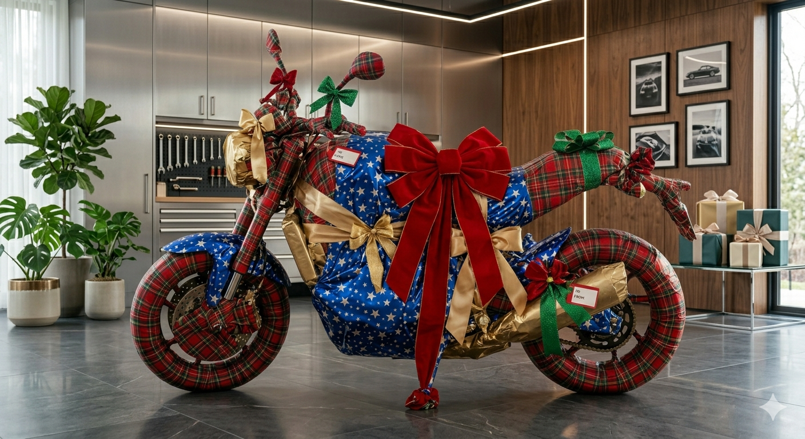
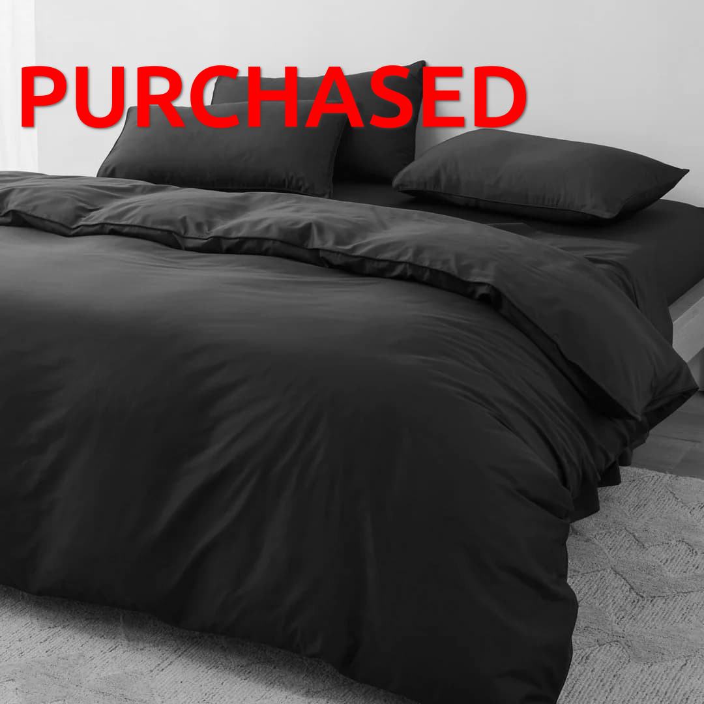
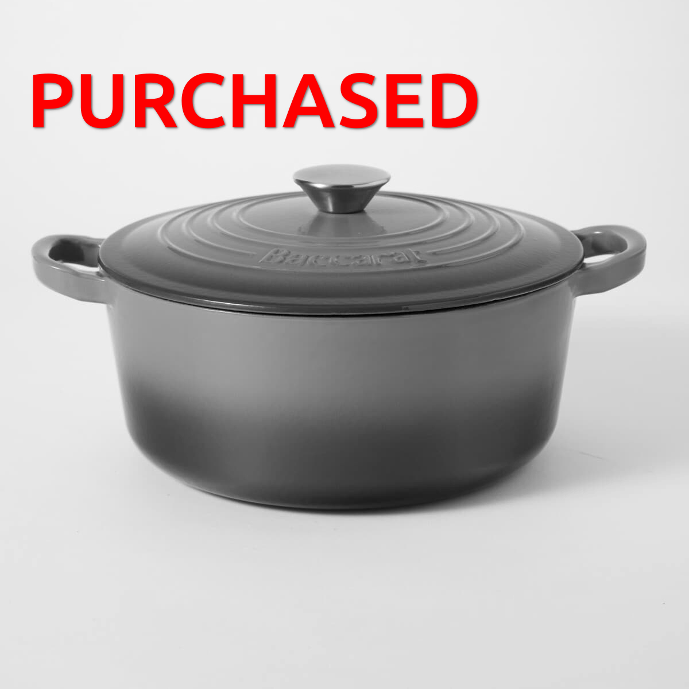
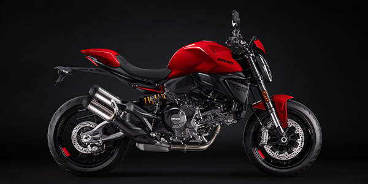

{style="border-radius: 30px;" width=90% fig-align="center"}

  <i class="bi bi-info-circle"></i> <strong>Note:</strong> Please make sure you click the button “I’ve Purchased This Item” after your purchase. I don’t feel like programming a more robust solution for this, sorry. <button type="button" class="btn-close" data-bs-dismiss="alert" aria-label="Close"></button>

We don't really like the idea of a registry, but we've been told that people buy you things regardless. So to prevent our house filling up with five different whiteware sets, we provide the items below for your consideration. We do not expect you to get anything here. In fact, we do not expect you to get *anything at all*.

::: {.callout-important title="Shipping address"}
23 Kererū Street \
Two Mile Bay \
Taupō \
Waikato \
3330
:::

  
Please expand this dropdown

  {style="border-radius: 30px;" width=60% fig-align="center"}

## lamp
{style="border-radius: 30px;" width=100% fig-align="center"}

[Buy this item](https://www.ikea.com/nz/en/p/varmblixt-led-table-wall-lamp-orange-glass-round-80525141/){.btn .btn-primary role="button"}

[I've Purchased This Item](https://docs.google.com/forms/d/e/1FAIpQLSeyLZHJW66ewn31h_Bxg0VkBsvwxVIv40VsfSgCTS7C0_PCFQ/viewform?usp=dialog){.btn .btn-primary}

## Another Lamp
{style="border-radius: 30px;" width=100% fig-align="center"}

I love lamp.

[Buy this item](https://www.ikea.com/nz/en/p/varptross-floor-lamp-bamboo-90601219/){.btn .btn-primary role="button"}

[I've Purchased This Item](https://docs.google.com/forms/d/e/1FAIpQLSeyLZHJW66ewn31h_Bxg0VkBsvwxVIv40VsfSgCTS7C0_PCFQ/viewform?usp=dialog){.btn .btn-primary}

## Temuka plates x2
{style="border-radius: 30px;" width=100% fig-align="center"}

[Buy this item](https://temukapottery.co.nz/products/studio-scandi-27cm-plate-cinnamon-glaze-effect){.btn .btn-primary role="button"}

[I've Purchased This Item](https://docs.google.com/forms/d/e/1FAIpQLSeyLZHJW66ewn31h_Bxg0VkBsvwxVIv40VsfSgCTS7C0_PCFQ/viewform?usp=dialog){.btn .btn-primary}

## Temuka snack bowls x2
{style="border-radius: 30px;" width=100% fig-align="center"}

[Buy this item](https://temukapottery.co.nz/products/studio-coupe-16cm-bowl-cinnamon-glaze-effect){.btn .btn-primary role="button"}

[I've Purchased This Item](https://docs.google.com/forms/d/e/1FAIpQLSeyLZHJW66ewn31h_Bxg0VkBsvwxVIv40VsfSgCTS7C0_PCFQ/viewform?usp=dialog){.btn .btn-primary}

## Temuka pasta bowls x2
{style="border-radius: 30px;" width=100% fig-align="center"}

[Buy this item](https://temukapottery.co.nz/products/potters-mark-pasta-bowl-manuka){.btn .btn-primary role="button"}

[I've Purchased This Item](https://docs.google.com/forms/d/e/1FAIpQLSeyLZHJW66ewn31h_Bxg0VkBsvwxVIv40VsfSgCTS7C0_PCFQ/viewform?usp=dialog){.btn .btn-primary}

## ~~Duvet cover and two pillow cases~~
{style="border-radius: 30px;" width=100% fig-align="center"}

~~Queen bed size. In colour "chocolate".~~

## Sheet set
{style="border-radius: 30px;" width=100% fig-align="center"}

Flat, fitted sheets and two pillow cases in colour "Oatmeal Marle".

[Buy this item](https://sheetsociety.com/en-nz/product/flannelette-bedding-oatmeal-marle){.btn .btn-primary role="button"}

[I've Purchased This Item](https://docs.google.com/forms/d/e/1FAIpQLSeyLZHJW66ewn31h_Bxg0VkBsvwxVIv40VsfSgCTS7C0_PCFQ/viewform?usp=dialog){.btn .btn-primary}

## Towels and hand towels
{style="border-radius: 30px;" width=100% fig-align="center"}

Two in "brown pod" two in "camouflage". So 4 in total. i.e., two towels and two hand towels. But not two of the same colour. So that's one "brown pod" towel and one "brown pod" hand towel, and one "camouflage" towel and one "camouflage" hand towel. Or actually, it's two "brown pod" items (one towel one hand towel), and two "camouflage" items (one towel one hand towel). A collection of 4 in two groups of two.

[Buy the towels](https://www.briscoes.co.nz/product/1129434/resene-orla-bath-towel/){.btn .btn-primary role="button"}

[Buy the matching hand towels](https://www.briscoes.co.nz/product/1129435/resene-orla-hand-towel/){.btn .btn-primary role="button"}

[I've Purchased This Item](https://docs.google.com/forms/d/e/1FAIpQLSeyLZHJW66ewn31h_Bxg0VkBsvwxVIv40VsfSgCTS7C0_PCFQ/viewform?usp=dialog){.btn .btn-primary}

## Bath Mat
{style="border-radius: 30px;" width=100% fig-align="center"}

In "Brown pod" colour.

[Buy this item](https://www.briscoes.co.nz/product/1109391/resene-aeon-bath-mat/){.btn .btn-primary role="button"}

[I've Purchased This Item](https://docs.google.com/forms/d/e/1FAIpQLSeyLZHJW66ewn31h_Bxg0VkBsvwxVIv40VsfSgCTS7C0_PCFQ/viewform?usp=dialog){.btn .btn-primary}

## Tallboy
{style="border-radius: 30px;" width=100% fig-align="center"}

[Buy this item](https://www.mocka.co.nz/products/osaka-tallboy-walnut/){.btn .btn-primary role="button"}

[I've Purchased This Item](https://docs.google.com/forms/d/e/1FAIpQLSeyLZHJW66ewn31h_Bxg0VkBsvwxVIv40VsfSgCTS7C0_PCFQ/viewform?usp=dialog){.btn .btn-primary}

## Bedside tables x2
{style="border-radius: 30px;" width=100% fig-align="center"}

[Buy this item](https://www.mocka.co.nz/products/blair-bedside-table-walnut){.btn .btn-primary role="button"}

[I've Purchased This Item](https://docs.google.com/forms/d/e/1FAIpQLSeyLZHJW66ewn31h_Bxg0VkBsvwxVIv40VsfSgCTS7C0_PCFQ/viewform?usp=dialog){.btn .btn-primary}

## Pasta thingy for KitchenAid
{style="border-radius: 30px;" width=100% fig-align="center"}

"Pasta in the kitchen" (trap beat in background).

[Buy this item](https://www.harveynorman.co.nz/home-appliances/kitchen-appliances/mixers/kitchenaid-pasta-roller-attachment.html){.btn .btn-primary role="button"}

[I've Purchased This Item](https://docs.google.com/forms/d/e/1FAIpQLSeyLZHJW66ewn31h_Bxg0VkBsvwxVIv40VsfSgCTS7C0_PCFQ/viewform?usp=dialog){.btn .btn-primary}

## Microwave
{style="border-radius: 30px;" width=100% fig-align="center"}

We like this one because it only has two buttons. A microwave needs no more than two buttons.

[Buy this item](https://www.harveynorman.co.nz/home-appliances/kitchen-appliances/microwaves/lg-neochef-25l-smart-inverter-1000w-microwave-black-ms2596ob.html){.btn .btn-primary role="button"}

[I've Purchased This Item](https://docs.google.com/forms/d/e/1FAIpQLSeyLZHJW66ewn31h_Bxg0VkBsvwxVIv40VsfSgCTS7C0_PCFQ/viewform?usp=dialog){.btn .btn-primary}

## ACME cutlery
[]{style="border-radius: 30px;" width=100% fig-align="center"}

[Buy this item](https://acmecups.nz/collections/cutlery){.btn .btn-primary role="button"}

[I've Purchased This Item](https://docs.google.com/forms/d/e/1FAIpQLSeyLZHJW66ewn31h_Bxg0VkBsvwxVIv40VsfSgCTS7C0_PCFQ/viewform?usp=dialog){.btn .btn-primary}

## Towbar Mounted Bike rack 
{style="border-radius: 30px;" width=65% fig-align="center"}

[Buy this item](https://www.evocycles.co.nz/Product/199392/thule-xpress-970-47-bike-carrier){.btn .btn-primary role="button"}

[I've Purchased This Item](https://docs.google.com/forms/d/e/1FAIpQLSeyLZHJW66ewn31h_Bxg0VkBsvwxVIv40VsfSgCTS7C0_PCFQ/viewform?usp=dialog){.btn .btn-primary}

## Couch for our lounge
{style="border-radius: 30px;" width=80% fig-align="center"}

This is a "daybed" from a furniture store we really like. It has good reviews and is a premium furniture piece that we would probably never bring ourselves to buy if it was not gifted to us.

[Buy this item](https://www.freedomfurniture.co.nz/product/24549042){.btn .btn-primary role="button"}

[I've Purchased This Item](https://docs.google.com/forms/d/e/1FAIpQLSeyLZHJW66ewn31h_Bxg0VkBsvwxVIv40VsfSgCTS7C0_PCFQ/viewform?usp=dialog){.btn .btn-primary}

## Dining room chairs (6 out of 6 available)
{style="border-radius: 30px;" width=80% fig-align="center"}

The dining room chairs we have now are pretty worn. These new ones would look amazing.

[Buy this item](https://nood.co.nz/products/barnaby-dining-chair-tan-pu){.btn .btn-primary role="button"}

[I've Purchased This Item](https://docs.google.com/forms/d/e/1FAIpQLSeyLZHJW66ewn31h_Bxg0VkBsvwxVIv40VsfSgCTS7C0_PCFQ/viewform?usp=dialog){.btn .btn-primary}

## Bath towels x2
{style="border-radius: 30px;" width=80% fig-align="center"}

In colour "glacier".

[Buy this item](https://www.briscoes.co.nz/product/1127556/royal-doulton-chelsea-bath-towel/){.btn .btn-primary role="button"}

[I've Purchased This Item](https://docs.google.com/forms/d/e/1FAIpQLSeyLZHJW66ewn31h_Bxg0VkBsvwxVIv40VsfSgCTS7C0_PCFQ/viewform?usp=dialog){.btn .btn-primary}

## Basically anything from *Chef's Compliments*
{style="border-radius: 30px;" width=60% fig-align="center"}

This is a local store on Gascoigne Street.

<iframe src="https://www.google.com/maps/embed?pb=!1m18!1m12!1m3!1d2923.821114931544!2d176.06914367584133!3d-38.685263784346816!2m3!1f0!2f0!3f0!3m2!1i1024!2i768!4f13.1!3m3!1m2!1s0x6d6bf0c7225eeb6d%3A0xf6091374a49216ba!2sChef's%20Complements!5e1!3m2!1sen!2snz!4v1786254712330!5m2!1sen!2snz" width="400" height="300" style="border:0;" allowfullscreen="" loading="lazy" referrerpolicy="strict-origin-when-cross-origin"></iframe>

## T.V. cabinet
{style="border-radius: 30px;" width=90% fig-align="center"}

We appreciate the one Teresa is lending us, but an upgrade would be lovely too.

[Buy this item](https://www.mocka.co.nz/products/osaka-buffet-walnut/){.btn .btn-primary role="button"}

[I've Purchased This Item](https://docs.google.com/forms/d/e/1FAIpQLSeyLZHJW66ewn31h_Bxg0VkBsvwxVIv40VsfSgCTS7C0_PCFQ/viewform?usp=dialog){.btn .btn-primary}

## ~~Pot~~
{style="border-radius: 30px;" width=100% fig-align="center"}

~~For cooking. Yum yum.~~

## Sauce pan
{style="border-radius: 30px;" width=60% fig-align="center"}

For cooking. Yum yum.

[Buy this item](https://www.farmers.co.nz/kitchen-dining/cookware/pots-pans/sauce-pans/baccarat-id3-hard-anodised-saucepan-20cm-6238665){.btn .btn-primary role="button"}

[I've Purchased This Item](https://docs.google.com/forms/d/e/1FAIpQLSeyLZHJW66ewn31h_Bxg0VkBsvwxVIv40VsfSgCTS7C0_PCFQ/viewform?usp=dialog){.btn .btn-primary}

## Za stone
{style="border-radius: 30px;" width=60% fig-align="center"}

For cooking. Yum yum.

[Buy this item](https://www.farmers.co.nz/kitchen-dining/cookware/specialty-cookware-accessories/stevens-brava-pizza-stone-with-wheel-cutter-38cm-6423950){.btn .btn-primary role="button"}

[I've Purchased This Item](https://docs.google.com/forms/d/e/1FAIpQLSeyLZHJW66ewn31h_Bxg0VkBsvwxVIv40VsfSgCTS7C0_PCFQ/viewform?usp=dialog){.btn .btn-primary}

## Salad things
{style="border-radius: 30px;" width=80% fig-align="center"}

For salads. Yum yum.

[Buy this item](https://citta.com/products/forge-salad-servers?_pos=1&_sid=3f97e879f&_ss=r){.btn .btn-primary role="button"}

[I've Purchased This Item](https://docs.google.com/forms/d/e/1FAIpQLSeyLZHJW66ewn31h_Bxg0VkBsvwxVIv40VsfSgCTS7C0_PCFQ/viewform?usp=dialog){.btn .btn-primary}

## Stereo speakers for lounge
{style="border-radius: 30px;" width=100% fig-align="center"}

I find myself hitting the max volume on our stereo a lot lately. I presume we will not be maxing these bad boys out.

[Buy this item](https://listeningpost.co.nz/shop/speakers/floorstanding-speakers/paradigm-monitor-se-6000f-speakers/){.btn .btn-primary role="button"}

[I've Purchased This Item](https://docs.google.com/forms/d/e/1FAIpQLSeyLZHJW66ewn31h_Bxg0VkBsvwxVIv40VsfSgCTS7C0_PCFQ/viewform?usp=dialog){.btn .btn-primary}

# stuff that John added
Do not take this section less seriously!

## 62 Tooth chainring for track bike
{style="border-radius: 30px;" width=80% fig-align="center"}

This would unlock a lot of new ratios for me. "Me" is John btw.

[Buy this item](https://www.velobike.co.nz/products/elite-track-chainring?variant=39324132212919){.btn .btn-primary role="button"}

[I've Purchased This Item](https://docs.google.com/forms/d/e/1FAIpQLSeyLZHJW66ewn31h_Bxg0VkBsvwxVIv40VsfSgCTS7C0_PCFQ/viewform?usp=dialog){.btn .btn-primary}

## Air compressor
{style="border-radius: 30px;" width=100% fig-align="center"}

You know when you have some air but you really just want that air in a smaller volume? That's what this is for. The ability to increase gas molecules' collisions with their container manifests as inflating car and bike tyres, dusting off parts, and other stuff.

[Buy this item](https://www.tradetested.co.nz/p/tools-hardware/air-compressors/compressors/hyundai-air-compressor-oil-free-low-noise-0-75hp-8l){.btn .btn-primary role="button"}

[I've Purchased This Item](https://docs.google.com/forms/d/e/1FAIpQLSeyLZHJW66ewn31h_Bxg0VkBsvwxVIv40VsfSgCTS7C0_PCFQ/viewform?usp=dialog){.btn .btn-primary}

## Office chair
[]{style="border-radius: 30px;" width=100% fig-align="center"}

[Buy option 1](https://www.ikea.com/nz/en/p/alefjaell-office-chair-grann-golden-brown-20419983/){.btn .btn-primary role="button"}

[Buy option 2](https://www.ikea.com/nz/en/p/oerfjaell-swivel-chair-white-vissle-dark-blue-s49501109/){.btn .btn-primary role="button"}

[I've Purchased This Item](https://docs.google.com/forms/d/e/1FAIpQLSeyLZHJW66ewn31h_Bxg0VkBsvwxVIv40VsfSgCTS7C0_PCFQ/viewform?usp=dialog){.btn .btn-primary}

## INCINERATOR!!!
{style="border-radius: 30px;" width=80% fig-align="center"}

Its for burning stuff outside. The owner of the company told me the "small" variant would be \$1652.05 including GST delivered to Taupo.

[Buy this item](https://www.mocka.co.nz/products/deven-ball-feet-storage-console-table-walnut){.btn .btn-primary role="button"}

[I've Purchased This Item](https://docs.google.com/forms/d/e/1FAIpQLSeyLZHJW66ewn31h_Bxg0VkBsvwxVIv40VsfSgCTS7C0_PCFQ/viewform?usp=dialog){.btn .btn-primary}

## Trainer for track bike
{style="border-radius: 30px;" width=100% fig-align="center"}

My legs are small. Help make me look like a freak again.

[Buy this item](https://www.evocycles.co.nz/Product/599943/wahoo-kickr-core-2-smart-trainer-with-zwift-click-cog){.btn .btn-primary role="button"}

[I've Purchased This Item](https://docs.google.com/forms/d/e/1FAIpQLSeyLZHJW66ewn31h_Bxg0VkBsvwxVIv40VsfSgCTS7C0_PCFQ/viewform?usp=dialog){.btn .btn-primary}

## Cash contribution

::: {.callout-tip}
## To contribute in N.Z. dollars, send to the following account:

01-0790-0216470-42 \
JOHN WHITING

:::

::: {.callout-tip}
## To contribute in U.S. dollars, send to our U.S. account using "Zelle":

johnryderwhiting@gmail.com \
JOHN WHITING

:::

## Ducati Monster (for Ella)
{style="border-radius: 30px;" width=100% fig-align="center"}

This is a practical mode of transportation fit for a fuel crisis. OK that's only partially true. Lets start again. This is a reliable and safe mode of transportation... OK that's definitely not true. What is true is decades of motorsport heritage and the most well known name in two wheeled transportation. I'm part Italian and it's just about the only Italian word I know. Reliable? Practical? You're asking the wrong questions! Is a Porsche reliable? A Patek Philippe practical? I don't know - wrong questions, and that's not why people buy them.

But wait a minute, is the value proposition for a Ducati really as ostentatious as a Porsche's or Patek Philippe's? They all seem to carry a similar calibre of excess but the Ducati Monster cost less then the cheapest new car you can buy and gives you the performance of a supercar. The Ducati Monster gets better gas economy than a Toyota prius. The Ducati Monster oil changes cost \$50. So yes, a Ducati is a inessential luxury item. But it still might be darn good value.

P.S. the answers to the questions you should be asking are

- _desmodromic valves,_
- _0.3 hp/lb (0.5 kW/kg),_
- _45,000 km service intervals,_
- _supercar performance from a vehicle cheaper than a Suzuki Ignis (look it up)._

[Buy this item](https://cyclespotauckland.co.nz/car/ducati/monster/999847251/){.btn .btn-primary role="button"}

[I've Purchased This Item](https://docs.google.com/forms/d/e/1FAIpQLSeyLZHJW66ewn31h_Bxg0VkBsvwxVIv40VsfSgCTS7C0_PCFQ/viewform?usp=dialog){.btn .btn-primary}

---

